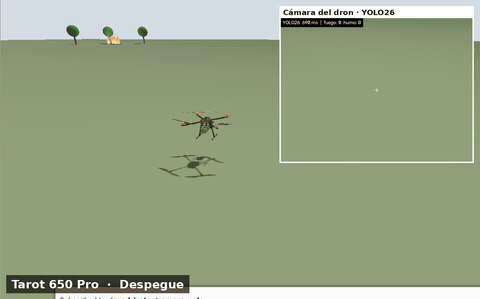
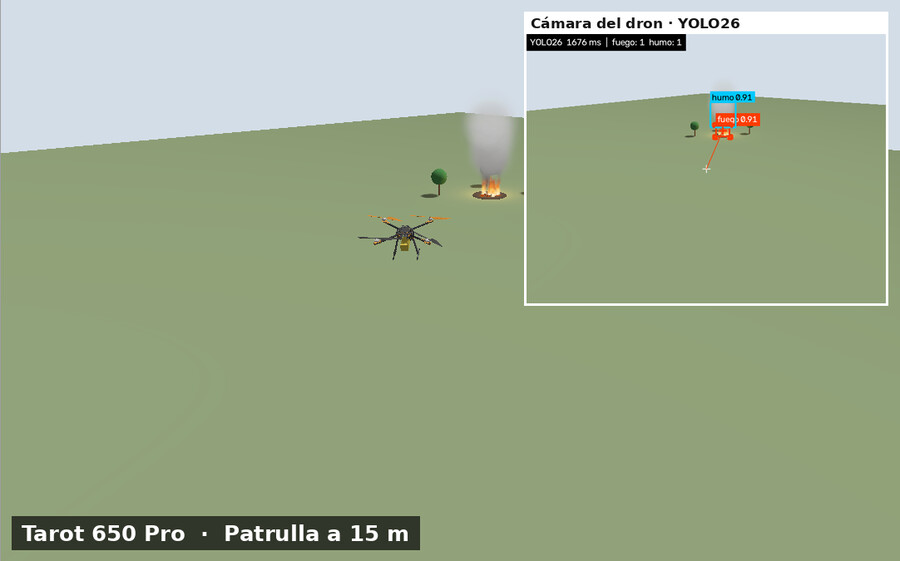
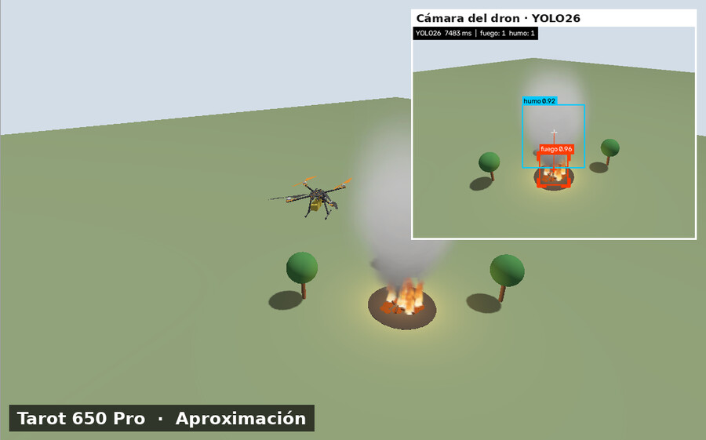
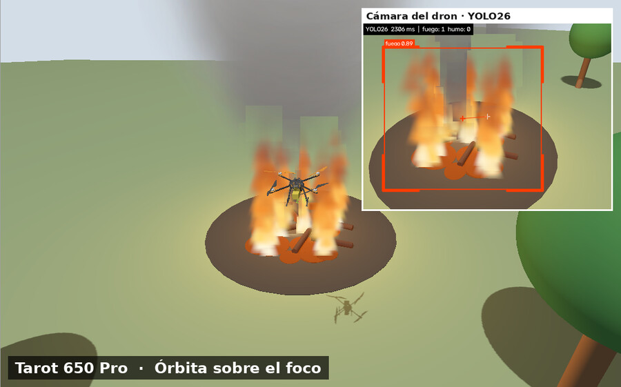
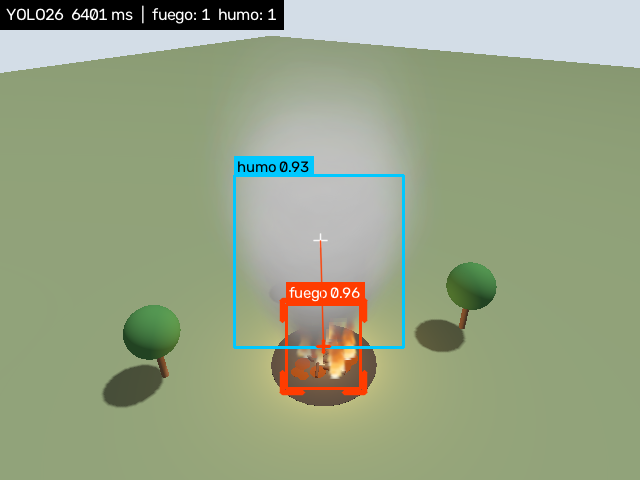

# Detección básica de incendio con ROS 2 y Gazebo en Ubuntu

Simulación de un cuadricóptero que busca un incendio forestal, lo detecta con una red YOLO26
sobre su cámara y lo orbita. Ubuntu 24.04, ROS 2 Jazzy y Gazebo Harmonic.

Cadena completa: imagen de la cámara → detección (YOLO26: `fuego`, `humo`) → estimación del foco
→ referencia → control (PD o super-twisting adaptativo con discretización implícita).

## Así funciona

Video completo (cámara del dron con las detecciones de YOLO, al doble de velocidad):
[docs/demo_busqueda_yolo.mp4](docs/demo_busqueda_yolo.mp4)

| Patrulla | Aproximación | Órbita sobre el foco |
|---|---|---|
|  |  |  |

Cámara del dron: YOLO26 detecta el fuego (confianza 0.93, 16 ms por imagen en una RTX 5060 Ti):

## Contenido

- `src/cuadrirotor_sim`: mundos (`incendio`, `bosque`), vehículos (Tarot 650 Pro, Tarot Ironman 650
  y cuadrirotor genérico), controladores PD y STA, detector YOLO (`yolo/incendio_yolo26n.pt`),
  planificador de búsqueda, viento y launch.
- `src/cuadrirotor_gz_plugins`: sistemas de Gazebo (`FuerzaViento`, `ComandosMotores`).

## Instalar

1. ROS 2 Jazzy y Gazebo Harmonic (`ros-jazzy-desktop`, `ros-jazzy-ros-gz`), más
   `ros-jazzy-actuator-msgs ros-jazzy-vision-msgs`.
2. Clonar y compilar:

       git clone https://github.com/jairoroke/Deteccion-basica-de-Incendio-con-ROS2-Gazebo-Ubuntu.git ~/ros2_ws
       cd ~/ros2_ws && colcon build --symlink-install && source install/setup.bash

3. Entorno de YOLO (con `--system-site-packages` para ver ROS 2):

       sudo apt install python3-venv
       python3 -m venv --system-site-packages ~/.venvs/yolo
       ~/.venvs/yolo/bin/pip install ultralytics "numpy<2" "opencv-python<4.12" "setuptools<80"

4. En WSL2 con GPU NVIDIA, agrega a `~/.bashrc` (si no, Gazebo renderiza en la CPU):

       export GALLIUM_DRIVER=d3d12
       export MESA_D3D12_DEFAULT_ADAPTER_NAME=NVIDIA

## Ejecutar

Búsqueda del incendio con el Tarot 650 en el mundo `incendio` (el panel "Detección YOLO" muestra
las cajas de fuego y humo):

    ros2 launch cuadrirotor_sim simulacion.launch.py mundo:=incendio vehiculo:=tarot650 controlador:=sta mision:=busqueda

Otras:

    ros2 launch cuadrirotor_sim simulacion.launch.py                                   # Tarot 650 Pro, hover a 3 m
    ros2 launch cuadrirotor_sim simulacion.launch.py controlador:=sta mision:=orbita viento:=true
    ros2 launch cuadrirotor_sim simulacion.launch.py vehiculo:=tarot650 mundo:=bosque controlador:=sta mision:=busqueda
    ros2 launch cuadrirotor_sim simulacion.launch.py vehiculo:=cuadrirotor            # cuadrirrotor genérico

Argumentos: `mundo` (incendio|bosque), `vehiculo` (tarot650pro|tarot650|cuadrirotor; por omisión
`tarot650pro`), `controlador` (pd|sta|ardupilot|ninguno), `mision` (hover|orbita|busqueda), `yolo`
(auto|true|false), `viento`, `gui`, `csv`. `controlador:=ardupilot` requiere ArduCopter SITL en
`~/ardupilot` y el plugin `ardupilot_gazebo`; la búsqueda con YOLO funciona con `pd` o `sta`.

## Detección con YOLO26

El detector (`detector_yolo`) corre en **todas las misiones** cuando está instalado el entorno de
YOLO (`yolo:=auto`, por omisión; `yolo:=false` lo apaga). En el panel "Detección YOLO" de Gazebo
cada objeto queda encuadrado y etiquetado con su clase y confianza (`fuego` en naranja, `humo` en
azul). El objetivo, el fuego más confiable o, si no hay, el humo, se marca con esquinas gruesas y
una línea desde el centro de la imagen. Usa la GPU si PyTorch tiene CUDA y, si no, la CPU
(`dispositivo:=auto`). Los umbrales de confianza se ajustan con los parámetros `confianza`,
`confianza_fuego` y `confianza_humo` del nodo.

El modelo (`yolo/incendio_yolo26n.pt`) se ajustó también con imágenes del mundo `incendio`: el
anterior, entrenado solo en `bosque`, tomaba por fuego los árboles simples de ese mundo. Evaluación
con imágenes nuevas (umbral 0.35, cámara con la óptica de la del dron, de 4 a 70 m del foco):

| | Modelo anterior | Modelo actual |
|---|---|---|
| `incendio`: imágenes con fuego visible en las que se detecta | 100 % | 100 % |
| `incendio`: vistas sin fuego (árboles) con un falso `fuego` | 92 de 200 | 0 de 200 |
| `bosque`: imágenes con humo visible en las que se detecta | 92.7 % | 100 % |
| `bosque`: precisión del humo | 0.84 | 0.93 |

Para reentrenarlo: generar imágenes de cada mundo con `scripts/capturar_dataset.py` (`--mundo
incendio` o `bosque`) y ajustar desde el modelo actual con `scripts/entrenar_yolo.py
<dataset_incendio> <dataset_bosque> --desde yolo/incendio_yolo26n.pt --epocas 10 --congelar 10 --lr0
0.001` (así se obtuvo el actual: 1200 imágenes de `incendio` y 800 de `bosque`, 40 min en CPU).

## Vehículos

| `vehiculo` | Qué es | Masa |
|---|---|---|
| `tarot650pro` (por omisión) | Armazón Tarot Ironman 650 con motores Tarot 4114/320KV a 6S, hélices 1555, batería 6S 8000 mAh y gimbal T4-3D con cámara | 2.74 kg |
| `tarot650` | Tarot Ironman 650 con motores T-Motor MN3508 y hélices de 15" | 2.2 kg |
| `cuadrirotor` | Cuadrirrotor genérico en "+" (cuerpo azul) | 1.5 kg |

Los dos Tarot usan las mallas del CAD del Ironman 650; el 650 Pro agrega la batería y el gimbal
bajo las placas, y su cámara va en el gimbal. Su masa, centro de masa e inercia salen de un
presupuesto de piezas (`PIEZAS_TAROT650PRO` en `scripts/generar_modelo.py`) con los datos del
fabricante para el armazón, los motores y el gimbal; el resto son valores típicos supuestos. Los
modelos y `config/vehiculo_<vehiculo>.yaml` se generan con `python3 scripts/generar_modelo.py`.

Verificado en Gazebo Harmonic con las leyes de control de `controlador_pd` y `controlador_sta`
(STA implícito, Ts = 5 ms) sobre gz-transport, sin ROS: el tarot650pro, en el mundo `incendio` y en
la órbita de 4 m alrededor del foco, sigue la referencia con error RMS de 0.013 m con PD y 0.041 m
con STA; con viento, 0.095 m con PD y 0.047 m con STA (el tarot650: 0.119 m y 0.048 m).

## Cómo encuentra el foco

El dron sale lejos del foco, patrulla a 15 m y, al ver humo, se dirige hacia él. Cada detección
de llamas da un rayo de cámara que se corta con el plano a 1.1 m; la mediana de esos cortes es el
foco. Una vez estimado, se descartan los cortes a más de 4 m (falsos positivos: en el mundo
`incendio` el modelo confunde a veces los árboles con fuego). Luego baja y orbita el foco.

Verificado (Tarot 650, mundo `incendio`): foco estimado (8.4, 5.4) frente al real (8, 5).

## Pruebas

    cd src/cuadrirotor_sim && python3 -m pytest -q test/

Al cerrar con Ctrl+C, el launch termina también el `gz sim` y, si lo hay, ArduCopter y MAVProxy.

Autor: Dr. Jairo Olguín Roque (FES Acatlán, UNAM).
