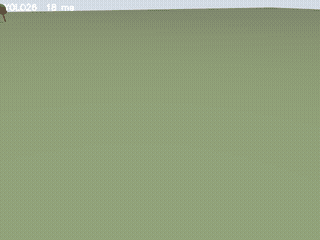
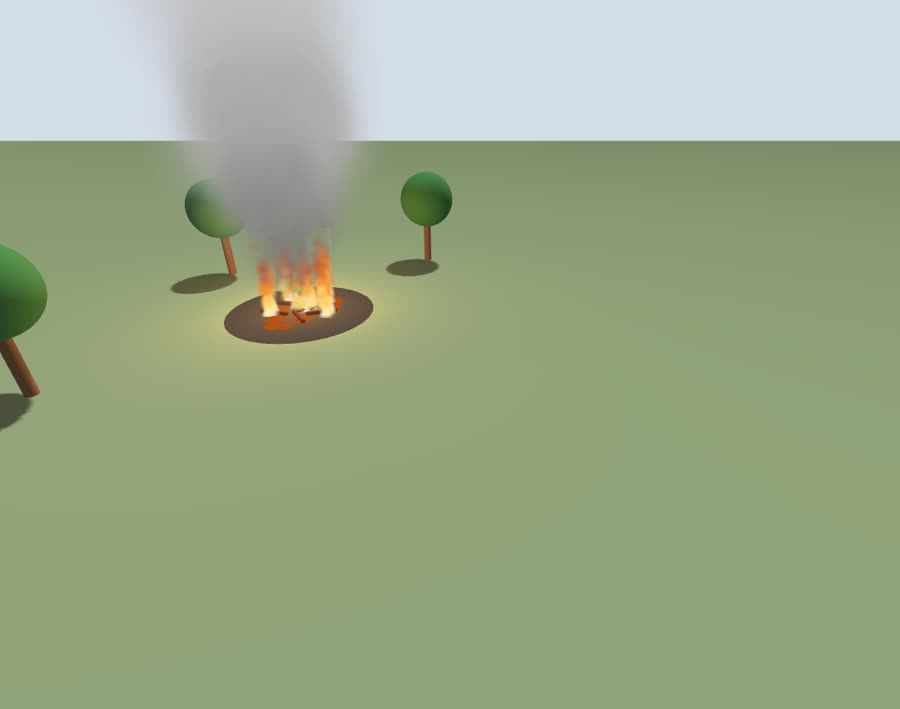
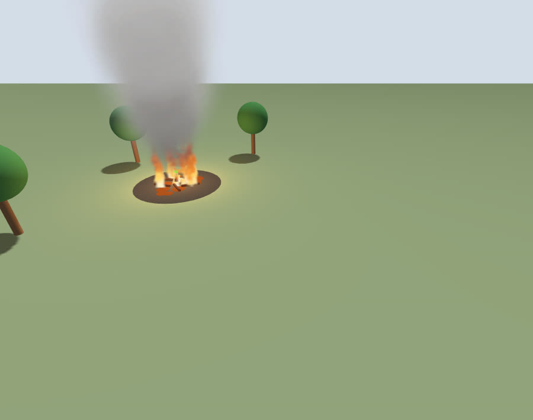
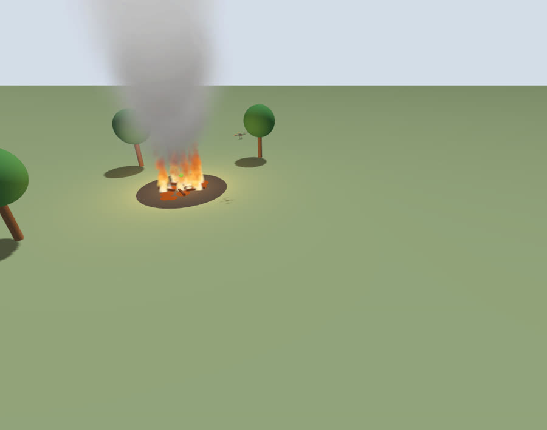
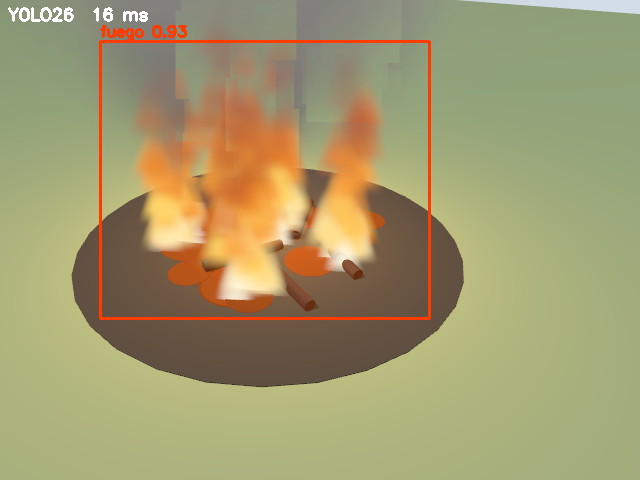

# Detección básica de incendio con ROS 2 y Gazebo en Ubuntu

Simulación de un cuadricóptero que busca un incendio forestal, lo detecta con una red YOLO26
sobre su cámara y lo orbita. Ubuntu 24.04, ROS 2 Jazzy y Gazebo Harmonic.

Cadena completa: imagen de la cámara → detección (YOLO26: `fuego`, `humo`) → estimación del foco
→ referencia → control (PD o super-twisting adaptativo con discretización implícita).

## Así funciona

Video completo (cámara del dron con las detecciones de YOLO, al doble de velocidad):
[docs/demo_busqueda_yolo.mp4](docs/demo_busqueda_yolo.mp4)

| Patrulla | Aproximación | Órbita sobre el foco |
|---|---|---|
|  |  |  |

Cámara del dron: YOLO26 detecta el fuego (confianza 0.93, 16 ms por imagen en una RTX 5060 Ti):

## Contenido

- `src/cuadrirotor_sim`: mundos (`incendio`, `bosque`), vehículos (cuadrirotor genérico y Tarot 650),
  controladores PD y STA, detector YOLO (`yolo/incendio_yolo26n.pt`), planificador de búsqueda,
  viento y launch.
- `src/cuadrirotor_gz_plugins`: sistemas de Gazebo (`FuerzaViento`, `ComandosMotores`).

## Instalar

1. ROS 2 Jazzy y Gazebo Harmonic (`ros-jazzy-desktop`, `ros-jazzy-ros-gz`), más
   `ros-jazzy-actuator-msgs ros-jazzy-vision-msgs`.
2. Clonar y compilar:

       git clone https://github.com/jairoroke/Deteccion-basica-de-Incendio-con-ROS2-Gazebo-Ubuntu.git ~/ros2_ws
       cd ~/ros2_ws && colcon build --symlink-install && source install/setup.bash

3. Entorno de YOLO (con `--system-site-packages` para ver ROS 2):

       sudo apt install python3-venv
       python3 -m venv --system-site-packages ~/.venvs/yolo
       ~/.venvs/yolo/bin/pip install ultralytics "numpy<2" "opencv-python<4.12" "setuptools<80"

4. En WSL2 con GPU NVIDIA, agrega a `~/.bashrc` (si no, Gazebo renderiza en la CPU):

       export GALLIUM_DRIVER=d3d12
       export MESA_D3D12_DEFAULT_ADAPTER_NAME=NVIDIA

## Ejecutar

Búsqueda del incendio con el Tarot 650 en el mundo `incendio` (el panel "Detección YOLO" muestra
las cajas de fuego y humo):

    ros2 launch cuadrirotor_sim simulacion.launch.py mundo:=incendio vehiculo:=tarot650 controlador:=sta mision:=busqueda

Otras:

    ros2 launch cuadrirotor_sim simulacion.launch.py                                   # hover a 3 m
    ros2 launch cuadrirotor_sim simulacion.launch.py controlador:=sta mision:=orbita viento:=true
    ros2 launch cuadrirotor_sim simulacion.launch.py vehiculo:=tarot650 mundo:=bosque controlador:=sta mision:=busqueda

Argumentos: `mundo` (incendio|bosque), `vehiculo` (cuadrirotor|tarot650), `controlador`
(pd|sta|ardupilot|ninguno), `mision` (hover|orbita|busqueda), `viento`, `gui`, `csv`.
`controlador:=ardupilot` requiere ArduCopter SITL en `~/ardupilot` y el plugin `ardupilot_gazebo`;
la búsqueda con YOLO funciona con `pd` o `sta`.

## Cómo encuentra el foco

El dron sale lejos del foco, patrulla a 15 m y, al ver humo, se dirige hacia él. Cada detección
de llamas da un rayo de cámara que se corta con el plano a 1.1 m; la mediana de esos cortes es el
foco. Una vez estimado, se descartan los cortes a más de 4 m (falsos positivos: en el mundo
`incendio` el modelo confunde a veces los árboles con fuego). Luego baja y orbita el foco.

Verificado (Tarot 650, mundo `incendio`): foco estimado (8.4, 5.4) frente al real (8, 5).

## Pruebas

    cd src/cuadrirotor_sim && python3 -m pytest -q test/

Al cerrar con Ctrl+C, el launch termina también el `gz sim` y, si lo hay, ArduCopter y MAVProxy.

Autor: Dr. Jairo Olguín Roque (FES Acatlán, UNAM).
