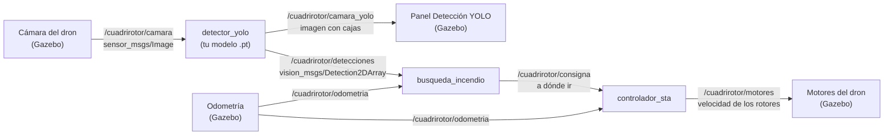

# Tutorial: usar tu propio modelo YOLO (.pt) en la simulación con ROS 2 y Gazebo

Ya entrenaste tu red y tienes un archivo de pesos, por ejemplo `best.pt`. En este tutorial lo
conectas a la simulación: el dron Tarot 650 Pro vuela en Gazebo, su cámara le pasa imágenes a
**tu** red, tu red encuentra el fuego y el humo, y con eso el dron busca el incendio y lo orbita.

Antes de los pasos se explica cómo funciona ROS 2 en este proyecto y para qué sirve cada
componente, para que sepas qué está pasando cuando lances la simulación.

**Necesitas:**

- El repositorio clonado y compilado en `~/ros2_ws` (README, sección *Instalar*). Si lo clonaste
  en otra carpeta, cámbiala en todos los comandos.
- El entorno de Python de YOLO en `~/.venvs/yolo` (README, *Instalar*, paso 3).
- Tu archivo de pesos `.pt`, entrenado con ultralytics (YOLO26, YOLO11 o YOLOv8).

**Resumen rápido** (cada paso se explica en la sección 3):

```bash
cd ~/ros2_ws && git pull
```

```bash
cp ~/Descargas/best.pt ~/ros2_ws/src/cuadrirotor_sim/yolo/modelo_equipo1.pt
```

```bash
cd ~/ros2_ws/src/cuadrirotor_sim && ~/.venvs/yolo/bin/python scripts/probar_modelo.py yolo/modelo_equipo1.pt
```

```bash
cd ~/ros2_ws && colcon build --symlink-install && source install/setup.bash
```

```bash
ros2 launch cuadrirotor_sim simulacion.launch.py mision:=busqueda controlador:=sta modelo_yolo:=$HOME/ros2_ws/src/cuadrirotor_sim/yolo/modelo_equipo1.pt
```

---

## 1. Cómo funciona ROS 2 en este proyecto

### 1.1 Las ideas básicas

ROS 2 (*Robot Operating System 2*) no es un sistema operativo: es una forma de dividir el
software de un robot en programas pequeños que se comunican entre sí. Las piezas son:

| Concepto | Qué es | Ejemplo en este proyecto |
|---|---|---|
| **Nodo** | Un programa que hace una sola tarea. | `detector_yolo` detecta fuego y humo; `controlador_sta` mueve los motores. |
| **Tópico** | Un canal con nombre por el que viajan datos. Quien lo **publica** escribe en él y quien está **suscrito** lo recibe. | `/cuadrirotor/camara` lleva las imágenes de la cámara. |
| **Mensaje** | El tipo de dato que viaja por un tópico, con campos definidos. | `sensor_msgs/Image` (una imagen), `vision_msgs/Detection2DArray` (una lista de cajas). |
| **Parámetro** | Un valor de configuración de un nodo que se fija al arrancarlo. | `confianza` del detector, `altura_busqueda` de la búsqueda. |
| **Launch** | Un archivo que arranca todos los nodos, el simulador y los parámetros con un solo comando. | `launch/simulacion.launch.py` |
| **Paquete** | Una carpeta con nodos, launch, modelos y configuración que se instala junta. | `cuadrirotor_sim` y `cuadrirotor_gz_plugins` |
| **Workspace** | La carpeta donde se compilan los paquetes (`src/`, `build/`, `install/`). | `~/ros2_ws` |

Algunas reglas que se usan en todo el tutorial:

- **`colcon build`** compila los paquetes de `src/` y deja el resultado en `install/`. ROS 2 usa
  lo de `install/`, no lo de `src/`.
- **`source install/setup.bash`** le dice a la terminal dónde está lo que compilaste. Hay que
  hacerlo **en cada terminal nueva**; si no, `ros2 launch` no encuentra el paquete.
- Los nodos no se conocen entre sí: solo comparten tópicos. Por eso puedes cambiar la red de
  detección sin tocar la búsqueda ni el control, siempre que publique lo mismo en el mismo tópico.
- **Tiempo simulado:** todos los nodos usan el reloj de Gazebo (`/clock`, `use_sim_time:=true`).
  Si tu computadora es lenta, la simulación va más despacio, pero los cálculos siguen siendo
  correctos.

### 1.2 Gazebo y el puente

**Gazebo** es el simulador: calcula la física (gravedad, empuje de las hélices, viento), dibuja
el mundo en 3D y simula los sensores del dron. Gazebo tiene sus propios tópicos (gz-transport),
distintos de los de ROS 2, así que hace falta un traductor:

**`ros_gz_bridge`** (el *puente*) copia mensajes entre Gazebo y ROS 2. Qué cruza y en qué sentido
está en `config/puente.yaml`:

| Tópico de ROS 2 | Mensaje | Sentido | Para qué |
|---|---|---|---|
| `/clock` | `rosgraph_msgs/Clock` | Gazebo → ROS | Reloj de la simulación |
| `/cuadrirotor/camara` | `sensor_msgs/Image` | Gazebo → ROS | Imagen de la cámara del dron (640x480, 15 por segundo) |
| `/cuadrirotor/odometria` | `nav_msgs/Odometry` | Gazebo → ROS | Posición, orientación y velocidad del dron |
| `/cuadrirotor/imu` | `sensor_msgs/Imu` | Gazebo → ROS | Acelerómetro y giróscopo |
| `/cuadrirotor/motores` | `actuator_msgs/Actuators` | ROS → Gazebo | Velocidad de cada uno de los 4 rotores |
| `/cuadrirotor/camara_yolo` | `sensor_msgs/Image` | ROS → Gazebo | Imagen con las cajas de tu red, para el panel "Detección YOLO" |
| `/cuadrirotor/viento` | `geometry_msgs/Vector3` | ROS → Gazebo | Fuerza del viento sobre el dron |

### 1.3 Los componentes y para qué sirve cada uno

**En Gazebo** (archivos `.sdf`, se cargan al lanzar):

| Componente | Archivo | Para qué sirve |
|---|---|---|
| Mundo `incendio` (o `bosque`) | `worlds/incendio.sdf` | Terreno, árboles, luz y el foco de incendio en (8, 5) |
| Foco de incendio | `models/foco_incendio/` | Llamas y columna de humo hechas con partículas; es lo que tu red debe detectar |
| Dron Tarot 650 Pro | `models/tarot650pro/model.sdf` | Cuerpo con masa e inercia, cámara frontal (inclinada 30° hacia abajo), IMU, los 4 motores (`MulticopterMotorModel`) y la odometría |
| Panel "Detección YOLO" | `config/gazebo_gui_yolo.config` | Ventana de Gazebo que muestra `/cuadrirotor/camara_yolo` (la imagen con tus cajas) |

**Nodos de ROS 2** (en `cuadrirotor_sim/`):

| Nodo | Lee | Publica | Para qué sirve |
|---|---|---|---|
| **`detector_yolo`** | `/cuadrirotor/camara` | `/cuadrirotor/detecciones`, `/cuadrirotor/camara_yolo` | **Aquí va tu modelo.** Pasa cada imagen por la red y publica las cajas de `fuego` y `humo` |
| `busqueda_incendio` | `/cuadrirotor/detecciones`, `/cuadrirotor/odometria` | `/cuadrirotor/consigna`, `/cuadrirotor/foco_estimado`, `/cuadrirotor/busqueda/estado` | El "cerebro" de la misión: patrulla, va hacia el humo, calcula dónde está el fuego, baja y lo orbita |
| `controlador_sta` (o `controlador_pd`) | `/cuadrirotor/consigna`, `/cuadrirotor/odometria` | `/cuadrirotor/motores` | Calcula la velocidad de cada rotor para seguir la consigna (control super-twisting o PD) |
| `ros_gz_bridge` | — | — | El puente de la sección 1.2 |
| `viento` (con `viento:=true`) | — | `/cuadrirotor/viento` | Perturbación de viento para probar el control |
| `mision_ardupilot` (con `controlador:=ardupilot`) | `/cuadrirotor/consigna` | MAVLink a ArduPilot | Usa ArduPilot SITL como piloto en lugar del controlador de ROS 2 |

**Configuración:**

| Archivo | Qué contiene |
|---|---|
| `launch/simulacion.launch.py` | Arranca Gazebo, el dron, el puente y los nodos según los argumentos (`mundo`, `vehiculo`, `controlador`, `mision`, `modelo_yolo`, ...) |
| `config/parametros.yaml` | Parámetros de la misión y del control, y los umbrales de la búsqueda |
| `config/vehiculo_tarot650pro.yaml` | Masa, inercia, motores y posición de la cámara del dron (la búsqueda los usa para calcular dónde está el fuego) |
| `yolo/incendio_yolo26n.pt` | El modelo del profesor, el que se usa si no indicas otro |

### 1.4 El recorrido de una imagen



Todas las flechas que salen de Gazebo o llegan a él pasan por `ros_gz_bridge`. En palabras:

1. Gazebo dibuja lo que ve la cámara del dron y lo publica 15 veces por segundo.
2. `detector_yolo` toma la imagen más reciente cada 0.1 s y la pasa por **tu red**. Con cada caja
   que supere el umbral de confianza (0.35 por omisión) publica una detección con:
   - el nombre de la clase **tal como está en tu modelo** (`class_id`);
   - la confianza (`score`);
   - el centro y el tamaño de la caja en píxeles.

   Además dibuja las cajas sobre la imagen para el panel de Gazebo.
3. `busqueda_incendio` usa solo las detecciones llamadas exactamente **`fuego`** y **`humo`** con
   confianza de al menos 0.45:
   - Con **humo** sabe hacia dónde volar, porque la columna sale del foco.
   - Con **fuego** calcula dónde está el foco en el suelo: traza el rayo de la cámara por el centro
     de la caja y lo corta con el plano de las llamas. Las cajas que tocan el borde de la imagen
     no se usan para esto, porque su centro no es el del fuego.
4. Con el foco estimado, la búsqueda manda consignas para bajar y orbitarlo, y el controlador las
   convierte en velocidades de los motores.

Por eso **los nombres de las clases importan**: si tu red las llama `fire` y `smoke`, verás las
cajas en el panel, pero el dron nunca irá hacia el fuego.

---

## 2. Qué debe cumplir tu modelo

| Requisito | Por qué | Cómo comprobarlo |
|---|---|---|
| Entrenado con **ultralytics** (YOLO26, YOLO11 o YOLOv8) | El detector lo carga con `from ultralytics import YOLO` | `scripts/probar_modelo.py` lo carga |
| Tarea de **detección** (cajas), no segmentación ni clasificación | La búsqueda necesita cajas | El script muestra `tarea: detect` |
| Clases llamadas **`fuego`** y **`humo`** (minúsculas, sin acento; el orden no importa) | La búsqueda solo usa esos nombres | El script lo revisa y, si no, las renombra |
| Entrenado con imágenes de 640 px (recomendado) | La cámara da 640x480 | El script muestra el tamaño de entrenamiento |
| La misma versión de ultralytics, o una más nueva, que la de `~/.venvs/yolo` | Un modelo de una versión más nueva puede no cargar en una vieja | Si no carga, actualiza ultralytics (sección 5) |

---

## 3. Paso a paso

### Paso 0. Actualiza tu copia del repositorio

El script que revisa tu modelo (`scripts/probar_modelo.py`), sus imágenes de prueba y el argumento
`confianza_yolo` se agregaron después de que clonaste el repositorio. Descárgalos con:

```bash
cd ~/ros2_ws && git pull
```

Si `git pull` se queja de cambios locales, guárdalos aparte con `git stash`, repite el
`git pull` y recupéralos con `git stash pop`.

### Paso 1. Copia tu modelo a la carpeta `yolo/` del paquete

Dale un nombre que identifique a tu equipo y no reemplaces el modelo del profesor
(`incendio_yolo26n.pt`): así puedes compararlos.

```bash
cp ~/Descargas/best.pt ~/ros2_ws/src/cuadrirotor_sim/yolo/modelo_equipo1.pt
```

(Cambia `~/Descargas/best.pt` por la ruta donde quedó tu archivo. Con ultralytics suele quedar en
`runs/detect/train/weights/best.pt`.)

### Paso 2. Revisa tu modelo antes de abrir Gazebo

`scripts/probar_modelo.py` comprueba tu modelo sin ROS ni Gazebo, en segundos:

- que cargue;
- que sea de detección;
- que tenga las clases `fuego` y `humo`;
- cómo detecta en 4 imágenes de la cámara del dron en Gazebo (`yolo/imagenes_prueba/`): fuego y
  humo de lejos, fuego de cerca, el mundo `bosque`, y una vista con **árboles sin fuego**, donde no
  debe marcar nada.

```bash
cd ~/ros2_ws/src/cuadrirotor_sim && ~/.venvs/yolo/bin/python scripts/probar_modelo.py yolo/modelo_equipo1.pt
```

Así se ve un modelo listo:

```
== 1. Modelo: yolo/modelo_equipo1.pt  (5.5 MB, ultralytics 8.4.202)
   tarea: detect
   clases: {0: 'fuego', 1: 'humo'}
   entrenado con imágenes de 640 px (la cámara del dron da 640x480)

== 2. Nombres de las clases
   OK: tiene 'fuego' y 'humo'

== 3. Prueba con 4 imágenes (umbral 0.35, CPU)
   01_fuego_humo_lejos.jpg      -> fuego 0.95, humo 0.93   OK
   02_fuego_cerca.jpg           -> fuego 0.92   OK
   03_fuego_humo_bosque.jpg     -> fuego 0.95, humo 0.88   OK
   04_sin_fuego_arboles.jpg     -> nada   OK
   tiempo medio: 36 ms por imagen
   imágenes marcadas en: /home/alumno/ros2_ws/src/cuadrirotor_sim/prueba_modelo

== Resultado
   El modelo está listo. Para usarlo en Gazebo:
   ros2 launch cuadrirotor_sim simulacion.launch.py mision:=busqueda controlador:=sta modelo_yolo:=/home/alumno/ros2_ws/src/cuadrirotor_sim/yolo/modelo_equipo1.pt
```

La última línea es el comando exacto del paso 5, con la ruta completa de tu archivo: puedes
copiarlo.

Abre la carpeta `prueba_modelo/` (dentro de `src/cuadrirotor_sim`) y mira las imágenes: tienen las
cajas dibujadas igual que el panel de Gazebo. Si alguna línea dice `REVISAR`, el script te dice qué esperaba ver. Por ejemplo,
`04_sin_fuego_arboles.jpg -> fuego 0.78 REVISAR` significa que tu red confunde los árboles con
fuego.

También puedes probar con tus propias imágenes:

```bash
~/.venvs/yolo/bin/python scripts/probar_modelo.py yolo/modelo_equipo1.pt --imagenes ~/fotos/*.jpg
```

### Paso 3 (solo si hace falta). Renombra las clases

Si el script dice `FALTA: ['fuego', 'humo']`, tus clases tienen otro nombre. El script te sugiere
qué poner después de `--renombrar` (revisa que cada nombre vaya con su clase). Por ejemplo, para
`fire` y `smoke`:

```bash
~/.venvs/yolo/bin/python scripts/probar_modelo.py yolo/modelo_equipo1.pt --renombrar fire=fuego smoke=humo --salida yolo/modelo_equipo1_es.pt
```

Esto crea una copia con los nombres correctos (los pesos no cambian) y la vuelve a probar. A
partir de aquí usa `modelo_equipo1_es.pt`.

### Paso 4. Compila y activa el workspace

```bash
cd ~/ros2_ws && colcon build --symlink-install && source install/setup.bash
```

Como en el paso 5 das la ruta completa de tu archivo, esto no es estrictamente necesario para tu
modelo. Pero así el `.pt` también queda instalado en el paquete, y es un buen hábito después de
cambiar cualquier archivo. Recuerda: `source install/setup.bash` **en cada terminal nueva**.

### Paso 5. Lanza la simulación con tu modelo

El argumento **`modelo_yolo`** le dice al launch qué archivo usar. Dale la ruta completa (con
`$HOME` o con `~`); así el comando funciona desde cualquier carpeta:

```bash
ros2 launch cuadrirotor_sim simulacion.launch.py mundo:=incendio controlador:=sta mision:=busqueda modelo_yolo:=$HOME/ros2_ws/src/cuadrirotor_sim/yolo/modelo_equipo1.pt
```

Qué hace este comando: abre Gazebo con el mundo `incendio`, aparece el Tarot 650 Pro en un claro
en (-40, -35), lejos del fuego, y arranca el puente y los nodos `detector_yolo` (con tu modelo),
`busqueda_incendio` y `controlador_sta`. El dron despega a 15 m, patrulla, va hacia el humo, ubica
el fuego, baja y lo orbita. Para terminar,
presiona **Ctrl+C** en la terminal.

### Paso 6. Comprueba que está usando tu modelo

**En la terminal del launch** busca esta línea; debe tener el nombre de **tu** archivo:

```
[detector_yolo-5] [INFO] [1795132798.606979977] [detector_yolo]: YOLO listo: modelo_equipo1.pt, clases {0: 'fuego', 1: 'humo'}, dispositivo cpu, umbrales {'fuego': 0.35, 'humo': 0.35}
```

(`dispositivo 0` significa que usa la GPU; `cpu`, que no hay GPU con CUDA y usa el procesador.)

Y los avisos de la búsqueda, que muestran que tus detecciones guían al dron (aquí sin el prefijo
`[busqueda_incendio-6] [INFO] [hora]`):

```
[busqueda_incendio]: [despegue] Subiendo a 15.0 m
[busqueda_incendio]: [patrulla] Recorriendo el bosque
[busqueda_incendio]: [hacia_humo] Humo a la vista, rumbo 40°
[busqueda_incendio]: Foco estimado con llamas: (8.1, 5.2)
[busqueda_incendio]: [aproximacion] Hacia el foco estimado (8.1, 5.2)
[busqueda_incendio]: [descenso] Sobre el anillo de órbita; foco en (7.9, 4.9)
[busqueda_incendio]: [orbita] Orbitando el foco
```

El foco real está en **(8, 5)**: entre más cerca quede tu estimación, mejor detecta tu red.

**En Gazebo**, el panel **"Detección YOLO"** muestra la cámara del dron con tus cajas: `fuego` en
naranja y `humo` en celeste, con su confianza. El objetivo lleva esquinas gruesas y una línea desde
el centro de la imagen.

**Con las herramientas de ROS 2.** Abre otra terminal y activa el workspace:

```bash
source ~/ros2_ws/install/setup.bash
```

Lista los nodos que están corriendo:

```bash
ros2 node list
```

```
/busqueda_incendio
/controlador_sta
/detector_yolo
/ros_gz_bridge
```

Lista los tópicos con su tipo de mensaje:

```bash
ros2 topic list -t
```

```
/clock [rosgraph_msgs/msg/Clock]
/cuadrirotor/busqueda/estado [std_msgs/msg/String]
/cuadrirotor/camara [sensor_msgs/msg/Image]
/cuadrirotor/camara_yolo [sensor_msgs/msg/Image]
/cuadrirotor/consigna [trajectory_msgs/msg/MultiDOFJointTrajectoryPoint]
/cuadrirotor/detecciones [vision_msgs/msg/Detection2DArray]
/cuadrirotor/foco_estimado [geometry_msgs/msg/PointStamped]
/cuadrirotor/motores [actuator_msgs/msg/Actuators]
/cuadrirotor/odometria [nav_msgs/msg/Odometry]
...
```

Cuántas imágenes por segundo procesa tu red. El detector toma una cada 0.1 s, así que el máximo
es 10; en CPU, o si Gazebo va lento, es normal que sean menos:

```bash
ros2 topic hz /cuadrirotor/camara_yolo
```

Lo que tu red publica para la búsqueda:

```bash
ros2 topic echo --once /cuadrirotor/detecciones
```

Sale algo así (recortado; los comentarios con `#` se agregaron aquí para explicar cada campo). En
la terminal verás además una parte `pose` muy larga, llena de ceros: este proyecto no la usa.

```yaml
header:
  stamp:
    sec: 42                      # momento (simulado) en que se tomó la imagen
    nanosec: 307000000
  frame_id: cuadrirotor/base_link/camara
detections:
- header: ...
  results:
  - hypothesis:
      class_id: humo             # el nombre de la clase en TU modelo
      score: 0.858               # la confianza
    pose: ...
  bbox:
    center:
      position:
        x: 395.0                 # centro de la caja, en píxeles
        y: 141.0
      theta: 0.0
    size_x: 63.0                 # ancho de la caja, en píxeles
    size_y: 88.0                 # alto de la caja, en píxeles
  id: ''
---
```

Hay un elemento en `detections` por cada caja. Si sale `detections: []`, tu red no ve nada en ese
momento: repite el comando cuando el panel muestre cajas.

Los parámetros con que arrancó el detector:

```bash
ros2 param get /detector_yolo modelo
```

```bash
ros2 param get /detector_yolo confianza
```

Si tienes `rqt_graph` instalado (viene con `ros-jazzy-desktop`), muestra el diagrama de la
sección 1.4 con los nodos y tópicos reales:

```bash
rqt_graph
```

### Paso 7. Ajusta los umbrales de confianza

Hay dos umbrales distintos:

| Umbral | Valor | Qué controla | Dónde se cambia |
|---|---|---|---|
| Del detector | 0.35 | Desde qué confianza se **dibuja y publica** una caja | Argumento del launch `confianza_yolo:=0.5` |
| De la búsqueda | 0.45 | Desde qué confianza una detección **guía al dron** | `config/parametros.yaml`, sección `busqueda_incendio`, `confianza` |

- Si tu red marca cosas que no son fuego (falsos positivos), **sube** los umbrales.
- Si casi no detecta, o lo hace con poca confianza, **bájalos**. La búsqueda nunca ve las cajas
  por debajo del umbral del detector, así que el de la búsqueda debe ser igual o mayor.

Ejemplo con umbral 0.5 en el detector:

```bash
ros2 launch cuadrirotor_sim simulacion.launch.py mision:=busqueda controlador:=sta confianza_yolo:=0.5 modelo_yolo:=$HOME/ros2_ws/src/cuadrirotor_sim/yolo/modelo_equipo1.pt
```

Después de editar `config/parametros.yaml`, vuelve a correr el paso 4 (`colcon build`).

### Paso 8. Compara tu modelo con el del profesor

```bash
cd ~/ros2_ws/src/cuadrirotor_sim && ~/.venvs/yolo/bin/python scripts/probar_modelo.py yolo/incendio_yolo26n.pt --resultados prueba_profesor
```

```bash
cd ~/ros2_ws/src/cuadrirotor_sim && ~/.venvs/yolo/bin/python scripts/probar_modelo.py yolo/modelo_equipo1.pt --resultados prueba_equipo1
```

Compara la confianza de cada detección, el tiempo por imagen y si alguno marca los árboles. En la
simulación, compara qué tan cerca de (8, 5) queda el foco estimado y cuánto tarda el dron en
encontrarlo.

---

## 4. Más experimentos

Agrega estos argumentos al comando del paso 5:

- **Otro mundo:** `mundo:=bosque`, con 85 árboles reales. Es más difícil, porque las copas tapan
  parte del fuego.
- **Con viento:** `viento:=true`, para ver si el control aguanta mientras tu red detecta.
- **Tu red en otras misiones:** `mision:=hover` o `mision:=orbita`. El detector corre en todas las
  misiones y verás tus cajas en el panel, aunque el dron no las use para moverse.
- **Pilotado por ArduPilot:** `controlador:=ardupilot` (README, sección *Con ArduPilot SITL*).
- **Mejorar tu red con imágenes de este simulador:**
  - `scripts/capturar_dataset.py` genera imágenes ya etiquetadas desde Gazebo
    (`--mundo incendio` o `--mundo bosque`).
  - `scripts/entrenar_yolo.py` entrena o hace ajuste fino con ellas (README, sección
    *Detección con YOLO26*).

---

## 5. Problemas comunes

| Lo que ves | Causa | Solución |
|---|---|---|
| `can't open file '.../scripts/probar_modelo.py'` | Tu copia del repositorio es anterior al script | Paso 0 (`git pull`) |
| El launch se detiene con `No se encontró el modelo YOLO: ...` | La ruta en `modelo_yolo:=` está mal escrita (el aviso muestra la ruta que buscó) | Compara con `ls $HOME/ros2_ws/src/cuadrirotor_sim/yolo/` y corrige el nombre o la carpeta |
| `No se encontró el entorno de Python de YOLO: ...` | No existe `~/.venvs/yolo` | Créalo (README, *Instalar*, paso 3) |
| El script o el detector dicen `No se pudo cargar el modelo` o `Can't get attribute ...` | Tu modelo se entrenó con una versión de ultralytics más nueva | Actualiza ultralytics, el comando va abajo de la tabla |
| En la terminal sale el nombre del modelo del profesor, no el tuyo | Faltó `modelo_yolo:=...` o la ruta apunta a otro archivo | Revisa la línea `YOLO listo: ...` y el comando |
| Ves cajas en el panel pero el dron nunca va al fuego | Las clases no se llaman `fuego` y `humo`, o las confianzas son menores que 0.45 | Paso 3 (renombrar) o paso 7 (umbrales) |
| El panel no tiene cajas | Tu red no reconoce el fuego simulado o el umbral es muy alto | Prueba con `scripts/probar_modelo.py` y baja `confianza_yolo`. Si sigue igual, entrena con imágenes del simulador (sección 4) |
| Con `mision:=hover` u `orbita`, la ventana dice "Cámara del dron" en lugar de "Detección YOLO" | El detector no arrancó (en la búsqueda, en cambio, el launch se detiene) | Busca en la terminal el aviso `Sin detector YOLO26 ...`, que dice qué falta |
| El dron confunde los árboles con fuego | La red no vio árboles de este mundo al entrenar | Agrega imágenes del mundo `incendio` al entrenamiento (`capturar_dataset.py --mundo incendio`) |
| Todo va muy lento | No hay GPU con CUDA y la red corre en el procesador | Es normal; la simulación usa tiempo simulado y el resultado no cambia. Cierra otros programas |
| `ros2: command not found` o `Package 'cuadrirotor_sim' not found` | La terminal no está activada | `source /opt/ros/jazzy/setup.bash` y luego `source ~/ros2_ws/install/setup.bash` |

Para actualizar ultralytics:

```bash
~/.venvs/yolo/bin/pip install -U ultralytics "numpy<2" "opencv-python<4.12" "setuptools<80"
```

---

## 6. Glosario

- **Pesos (`.pt`):** los números que la red aprendió al entrenar. El archivo trae la red completa
  y los nombres de sus clases.
- **Confianza (`score`):** qué tan segura está la red de una detección, de 0 a 1.
- **Caja (*bounding box*):** el rectángulo que encierra al objeto, en píxeles de la imagen.
- **Consigna:** la posición, velocidad y orientación a la que el controlador debe llevar al dron.
- **Odometría:** posición, orientación y velocidad del dron, que aquí da Gazebo directamente.
- **SDF:** el formato de los archivos de Gazebo para mundos y modelos.
- **Puente (`ros_gz_bridge`):** el nodo que traduce mensajes entre Gazebo y ROS 2.
- **SITL (*Software In The Loop*):** el piloto automático ArduPilot corriendo en la computadora en
  lugar de en el dron real.
